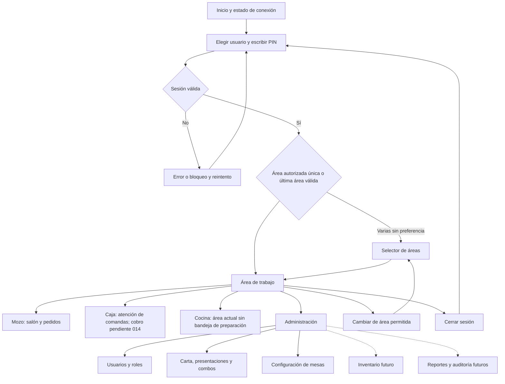
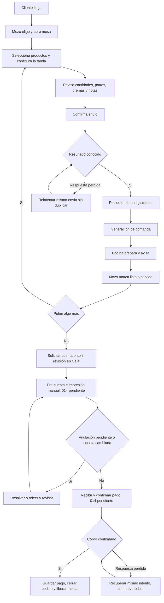

# Sistema Pollería — Requerimientos y brief para app flow, task flows y UI/UX

Fecha de corte: **14 de octubre de 2026**. Documento de traspaso para diseñar el sistema completo en otra sesión. Idioma del producto: español de Perú. Moneda: soles (S/). Zona horaria del negocio: America/Lima.

## 1. Cómo usar este documento

Este documento reúne el negocio, todos los RF/RNF originales, las decisiones posteriores, los permisos, la arquitectura de información, los flujos y las pantallas necesarias. Puede compartirse como brief con una nueva conversación o con un diseñador sin reconstruir el chat anterior.

Distinguir tres estados en los diseños y prototipos:

- **Actual:** implementado en la rama `dev` al corte. Se puede contrastar con la aplicación y las capturas.
- **Aprobado, pendiente de implementar:** primer bloque de Caja, spec 014. Sus reglas ya fueron acordadas; todavía no existe cobro funcional en `dev`.
- **Futuro / por definir:** requisitos del sistema completo que aún no tienen una spec aprobada o necesitan decisiones de negocio. Pueden tener wireframes, claramente etiquetados como propuesta; no presentarlos como funciones disponibles.

Las specs aprobadas y las decisiones posteriores del usuario precisan la planificación original. Este brief no reemplaza los criterios de aceptación ni autoriza cambios de negocio. Para diseñar basta con estos requisitos; para implementar, leer también la spec del módulo y el contrato API.

### Fuentes y acceso

- Repositorio: https://github.com/brayanAndy1996/polleria-1 — usar `dev` como referencia visual y funcional actual.
- [Planificación original](planificacion.md): negocio, HU-01…HU-20, RF-01…RF-27 y RNF-01…RNF-14.
- [Constitución](../CLAUDE.md), [instrucciones vigentes](../AGENTS.md), [progreso](PROGRESS.md) y [traspaso técnico](CONTINUAR.md).
- [Specs 001…013 y preparación demo](specs/), [contrato actual](api/openapi.yaml) y [guía de prueba](PROBAR-DEMO.md).
- [Capturas de la interfaz actual](ui-redesign/README.md), como punto de comparación; el usuario pidió una dirección visual nueva después de esta entrega.
- Spec 014 **en otra rama**: https://github.com/brayanAndy1996/polleria-1/blob/feat/014-cashier-payments/docs/specs/014-cashier-payments/spec.md — corte `62e0243`. No asumir que esa carpeta está en `dev`.
- Referencia visual: https://www.pinterest.com/pin/9570217954203579/ — imagen compartida por el usuario titulada «Système POS pour Restaurant». Si la nueva sesión no puede abrir el enlace, volver a adjuntar la imagen; no está guardada como archivo en el repositorio.
- Archivo de diseño indicado por el usuario: https://www.figma.com/design/AFptvrcQPGhNiFTPUy55Pj/polleria — **nombre `polleria`**. También solicitó editarlo con el MCP de **FigCraft**. Al corte no se pudo verificar acceso ni capacidad de edición; no se ha escrito ningún diseño en ese archivo desde esta sesión. La nueva sesión debe comprobar las herramientas y permisos reales antes de afirmar acceso.

## 2. Producto, usuarios y contexto de trabajo

Aplicación web para una pollería pequeña de **Huánuco, Perú**, que hoy toma pedidos en papel o de palabra y cobra con sumas manuales. El objetivo es atender con menos errores, enviar el detalle correcto a cocina, cobrar sin duplicaciones y conocer ventas e inventario.

Se usa durante el servicio, con ruido, presión de tiempo, varios trabajadores y posibles cortes de wifi. Los mozos trabajan desde celulares Android; caja desde PC o tablet; el dueño desde PC/celular. La operación de cocina acordada se apoya en **comandas impresas y aviso verbal/campana**, no exige una pantalla de preparación. El cliente es participante del servicio, pero **no tiene cuenta, portal, app de autoservicio ni pago online definidos**.

La aplicación debe funcionar en la red local aunque falle internet. Eso no significa que hoy pueda enviar pedidos sin conexión al servidor: una caída de wifi necesita aviso y reintento seguro, no un falso éxito ni sincronización offline inventada.

### Productos y vocabulario

- Pollo a la brasa: octavo (1/8), cuarto (1/4), medio (1/2) y entero; partes pecho y pierna. Papas, ensalada y cremas según la oferta del local.
- Otros platos: chaufa, salchipapa, parrillas, mollejitas, postres y extras según la carta configurada.
- Combos: precio propio y composición explícita, por ejemplo mostrito; sus componentes no se cobran dos veces.
- Bebidas compradas por unidad/botella; bebidas preparadas como chicha, maracuyá o limonada por vaso/jarra. El inventario detallado de preparados necesita una spec futura.
- **Carta:** catálogo. **Pedido:** cuenta abierta de una o varias mesas. **Tanda:** conjunto de ítems confirmados en un envío. **Comanda:** instrucciones para cocina; no es cuenta ni comprobante. **Pre-cuenta:** detalle para revisar el importe; no registra pago. **Cobro:** registro de pago confirmado. **Merma:** pérdida/sobrante, definición exacta pendiente para reportes.

### Objetivos medibles de UX

- Registrar un pedido típico de cuarto pierna + bebida en menos de **30 segundos**.
- Aprender las tareas básicas en menos de **una hora**.
- Identificar mesa, presentación, parte, total y estado sin ambigüedad.
- Evitar envíos, copias y cobros duplicados incluso con doble toque o respuesta perdida.
- Recuperarse de errores con datos conservados y una siguiente acción clara.

## 3. Roles y permisos

Una persona puede tener varios roles. La navegación muestra las áreas permitidas; cambiar de área no requiere cerrar sesión. Un administrador puede entrar a todas las áreas. Los permisos dependen del usuario autenticado, no de cómo se dibuje un botón.

| Acción / área                                                                | Mozo                               | Cajero                        | Cocina                            | Administrador                                                 |
| ---------------------------------------------------------------------------- | ---------------------------------- | ----------------------------- | --------------------------------- | ------------------------------------------------------------- |
| Iniciar/cerrar sesión, consultar carta                                       | Sí                                 | Sí                            | Sí                                | Sí                                                            |
| Salón `/mozo`, abrir/tomar pedido, mover/unir/separar, servido, pedir cuenta | Sí                                 | No salvo rol mozo             | No salvo rol mozo                 | Sí                                                            |
| Marcar listo en la operación de pedidos                                      | Sí                                 | No salvo otro rol permitido   | Sí por API; no bandeja web actual | Sí                                                            |
| Solicitar anulación de ítem                                                  | Sí                                 | No salvo rol mozo             | No                                | Sí; puede resolver/directa                                    |
| Aprobar/rechazar/anular directamente                                         | No                                 | No                            | No                                | Sí                                                            |
| Cancelar pedido que tuvo ítems, con motivo y condiciones                     | No                                 | No                            | No                                | Sí                                                            |
| Cancelar pedido vacío según reglas vigentes                                  | Sí, si elegible                    | No salvo otro rol permitido   | No                                | Sí                                                            |
| Ver avisos de comandas fallidas                                              | Sí                                 | Sí                            | Sin bandeja de atención           | Sí                                                            |
| Solicitar copia de comanda                                                   | INICIAL/ADICIONAL, si `canReprint` | Todos los tipos, si permitido | No                                | Todos los tipos, si permitido                                 |
| Pre-cuenta y su impresión (014 pendiente)                                    | Sí                                 | Sí                            | No                                | Sí                                                            |
| Cobrar/consultar pago (014 pendiente)                                        | No                                 | Sí                            | No                                | Sí                                                            |
| Usuarios, productos, presentaciones, combos y configuración de mesas         | No                                 | No                            | No                                | Sí                                                            |
| Inventario y reportes futuros                                                | No definido                        | No definido                   | No definido                       | Administrador según planificación; permisos finos por definir |

No añadir un PIN de administrador por cada cobro normal: la 014 no lo exige. La anulación se resuelve con sesión de administrador y motivo; no inventar un diálogo de PIN supervisor como sustituto del flujo aprobado. Permisos futuros de descuentos, caja e inventario deben confirmarse.

## 4. Todos los requerimientos funcionales y su estado

La columna de prioridad conserva la planificación original. «Parcial» indica que solo parte del RF está implementada. La columna de diseño explica cómo representarlo sin confundir la operación real con el futuro.

| ID    | Módulo      | Requerimiento original                                                                                                               | Prioridad | Estado / precisión para diseño                                                                             |
| ----- | ----------- | ------------------------------------------------------------------------------------------------------------------------------------ | --------- | ---------------------------------------------------------------------------------------------------------- |
| RF-01 | Usuarios    | El sistema permite iniciar sesión con usuario y PIN, y muestra solo las funciones del rol (mozo, cocina, cajero, administrador).     | Alta      | Actual: specs 003/004; múltiples roles y gestión de usuarios.                                              |
| RF-02 | Mesas       | El sistema muestra todas las mesas con su estado: libre, ocupada, pedido listo o cuenta solicitada.                                  | Alta      | Actual: 009/011, estados derivados.                                                                        |
| RF-03 | Mesas       | El mozo puede abrir una mesa, cambiar un pedido de mesa y unir mesas.                                                                | Media     | Actual: 009/011; incluye separar mesas.                                                                    |
| RF-04 | Pedidos     | El mozo registra un pedido eligiendo producto, presentación (1/8, 1/4, 1/2, entero) y parte (pecho o pierna).                        | Alta      | Actual: 006/010/011; ver combinaciones válidas.                                                            |
| RF-05 | Pedidos     | El mozo puede indicar cremas, bebidas y observaciones por ítem (por ejemplo "sin ensalada").                                         | Alta      | Actual: 010/011; cremas seleccionables y notas por ítem.                                                   |
| RF-06 | Pedidos     | El mozo puede agregar ítems a un pedido abierto; cada adición genera una comanda nueva.                                              | Alta      | Actual: 010/013; solo la tanda nueva.                                                                      |
| RF-07 | Pedidos     | Anular un ítem ya enviado a cocina requiere autorización del administrador y guarda el motivo.                                       | Media     | Actual: solicitud, aprobación/rechazo y anulación directa por admin; 010/011.                              |
| RF-08 | Cocina      | Al enviar un pedido, el sistema imprime automáticamente la comanda en la impresora de cocina con número, mesa, mozo, hora y detalle. | Alta      | Parcial: 013 genera archivos; hardware físico pendiente.                                                   |
| RF-09 | Cocina      | Las adiciones y anulaciones imprimen una comanda nueva identificada como ADICIONAL o ANULADO.                                        | Alta      | Actual con driver file: INICIAL/ADICIONAL/ANULADO.                                                         |
| RF-10 | Cocina      | Si la impresora de cocina falla o se queda sin papel, el sistema avisa al mozo y a caja, y permite reimprimir la comanda.            | Alta      | Parcial: fallos de archivo, salida incierta y copias; papel/hardware no verificados.                       |
| RF-11 | Cocina      | El sistema puede enviar las bebidas a una impresora de barra separada de la de cocina.                                               | Baja      | Futuro: barra separada sin spec aprobada.                                                                  |
| RF-12 | Para llevar | El sistema registra pedidos para llevar y delivery con nombre, teléfono, dirección y costo de envío.                                 | Media     | Futuro: modalidades sin mesa; alcance y reglas por definir.                                                |
| RF-13 | Caja        | El sistema calcula automáticamente el total de la mesa y permite imprimir una pre-cuenta.                                            | Alta      | Total actual; pre-cuenta e impresión de navegador aprobadas en 014, pendientes.                            |
| RF-14 | Caja        | El cajero registra el pago en efectivo (con cálculo de vuelto), Yape, Plin o tarjeta.                                                | Alta      | Aprobado en 014: pago completo con un medio; aún sin implementación.                                       |
| RF-15 | Caja        | El sistema permite dividir la cuenta y pagos mixtos (parte efectivo, parte Yape).                                                    | Media     | Futuro: fuera de 014; pagos mixtos y división por definir.                                                 |
| RF-16 | Caja        | El cajero abre la caja con un monto inicial y la cierra con un cuadre por medio de pago.                                             | Media     | Futuro: fuera de 014; apertura/cierre/cuadre por definir.                                                  |
| RF-17 | Caja        | El sistema emite un ticket de venta; la boleta o factura electrónica SUNAT queda como fase posterior.                                | Media     | Futuro: ticket de venta fuera de 014; SUNAT posterior.                                                     |
| RF-18 | Carta       | El administrador crea y edita productos, combos, presentaciones y precios, y los activa o desactiva.                                 | Alta      | Actual: 005…008; activar/desactivar sin borrar historia.                                                   |
| RF-19 | Carta       | Cada producto define cuánto pollo consume, de qué parte, y qué bebida o insumo descuenta.                                            | Alta      | Parcial: consumo teórico de pollo/combos; descuento de insumos futuro.                                     |
| RF-20 | Inventario  | El administrador registra los pollos asados del día; el sistema los convierte en cuartos u octavos de pecho y pierna.                | Alta      | Futuro: entradas de pollo asado por parte.                                                                 |
| RF-21 | Inventario  | Cada venta descuenta automáticamente el stock de pollo, gaseosas y refrescos.                                                        | Alta      | Futuro: no existe descuento de stock en pedidos/cobro actuales.                                            |
| RF-22 | Inventario  | La carta del mozo muestra el stock disponible y bloquea productos agotados.                                                          | Alta      | Futuro: activo/inactivo actual no equivale a stock disponible.                                             |
| RF-23 | Inventario  | El administrador registra compras de gaseosas e insumos y la producción de refrescos (jarras a vasos).                               | Media     | Futuro: unidades, compras, recetas y rendimientos por definir.                                             |
| RF-24 | Inventario  | El sistema alerta cuando un producto o insumo baja de su stock mínimo.                                                               | Media     | Futuro: mínimos, alertas y destinatarios por definir.                                                      |
| RF-25 | Reportes    | El sistema muestra ventas por día y por hora, productos más vendidos y ventas por mozo.                                              | Alta      | Futuro: reportes sin módulo implementado.                                                                  |
| RF-26 | Reportes    | El sistema muestra ventas por medio de pago y la merma de pollos (asados menos vendidos).                                            | Media     | Futuro: conciliación por medio y definición de merma por precisar.                                         |
| RF-27 | Auditoría   | El sistema registra quién anuló, modificó o cobró cada pedido y a qué hora.                                                          | Media     | Parcial: motivos/actores de anulaciones y copias; auditoría de pago prevista en 014, visor general futuro. |

### Requisitos actuales que amplían el catálogo original

- Administración de usuarios: alta, lista activos/inactivos, editar nombre visible/roles, restablecer PIN y activar/desactivar. No exponer PIN guardados. Evitar dejar al sistema sin administrador activo. El restablecimiento/desactivación y los cambios de permisos deben respetar la revocación de sesiones definida por la spec 004.
- Administración de carta: categorías fijas Pollo, Combos, Platos, Bebidas, Postres, Cremas y Extras; no existe CRUD de categorías. Gestión de presentaciones y precios por parte; composición de combos sin combos anidados.
- Administración de mesas: crear, renombrar, activar/desactivar; nombre único también entre inactivas. No desactivar una mesa ocupada.
- Atención de impresión: estados consultables, paginación, relectura periódica y copia con motivo, sin reenviar la venta.

## 5. Requerimientos no funcionales para el diseño

Se conservan todos los RNF originales. Son objetivos/requisitos del producto; esta lista **no significa que todos estén medidos o implementados**.

| ID     | Tipo           | Requerimiento                                                                                                       | Prioridad |
| ------ | -------------- | ------------------------------------------------------------------------------------------------------------------- | --------- |
| RNF-01 | Usabilidad     | Un mozo registra un pedido típico (1/4 pierna + bebida) en menos de 30 segundos.                                    | Alta      |
| RNF-02 | Usabilidad     | La interfaz usa botones grandes, íconos y español sencillo; un trabajador aprende a usarla en menos de una hora.    | Alta      |
| RNF-03 | Rendimiento    | Una comanda se imprime en cocina en menos de 3 segundos tras enviarse.                                              | Alta      |
| RNF-04 | Rendimiento    | El sistema soporta al menos 20 mesas y 5 dispositivos conectados a la vez sin demoras.                              | Alta      |
| RNF-05 | Disponibilidad | El sistema funciona en la red local aunque se caiga el internet.                                                    | Alta      |
| RNF-06 | Disponibilidad | Se hace una copia de seguridad diaria de la base de datos.                                                          | Media     |
| RNF-07 | Compatibilidad | Funciona en Chrome para Android 9 o superior y en una PC con Windows 10 o superior.                                 | Alta      |
| RNF-08 | Compatibilidad | Funciona con celulares y tablets de gama baja (2 GB de RAM).                                                        | Media     |
| RNF-09 | Seguridad      | Cada usuario accede con PIN propio; las acciones sensibles (anular, descuentos, cierre de caja) piden autorización. | Alta      |
| RNF-10 | Seguridad      | Las contraseñas y PIN se guardan cifrados.                                                                          | Media     |
| RNF-11 | Costo          | El hardware total adicional no supera un presupuesto accesible para una pollería pequeña (a definir con el dueño).  | Media     |
| RNF-12 | Mantenibilidad | Precios, productos y mesas se configuran desde el sistema sin tocar código.                                         | Alta      |
| RNF-13 | Legal          | Los comprobantes cumplirán la normativa SUNAT vigente cuando se active la facturación electrónica.                  | Baja      |
| RNF-14 | Escalabilidad  | El diseño permite usar el mismo sistema en varias pollerías (cada una con sus propios datos).                       | Baja      |

### Traducción a decisiones de interfaz

- Botones de al menos **48 × 48 px**, foco visible, navegación por teclado, campos con etiqueta persistente y errores junto al campo. No depender solo de color, iconos o hover.
- Adaptar a **360/390 px** móvil, **768 px** tablet y **1440 px** escritorio; sin desplazamiento horizontal de página ni acciones ocultas por teclado, cabeceras o paneles fijos.
- En PC: carta y pedido pueden convivir. En móvil: carta → configuración → resumen/carrito accesible → envío; evitar reducir tres columnas de escritorio a texto ilegible.
- Recursos locales y ligeros; no depender de fuentes, fotografías o servicios remotos durante el servicio. No prometer notificaciones/tiempo real que el módulo actual no ofrece.
- RNF-03: la validación actual de 013 mide archivo/confirmación bajo condiciones de prueba, no salida física ni detección de papel. Refresco de UI no equivale a ese tiempo de impresión.
- RNF-10: los PIN se guardan como **hash bcrypt**, no texto recuperable. Ocultarlos en la interfaz y no incluirlos en ejemplos de auditoría.
- RNF-06/11/13/14: backups, presupuesto, SUNAT y múltiples negocios necesitan solución/validación posterior; no dibujar configuración disponible ni cumplimiento ya logrado.

## 6. Reglas de negocio que el diseño debe preservar

### Dinero y cantidades

1. **Toda interacción monetaria está en soles.** Ejemplo: total **S/ 21,00**, recibido **S/ 30,00**, vuelto **S/ 9,00**. Nunca mostrar `2100` como precio de veintiún soles ni pedir céntimos al usuario.
2. La 014 admite entrada `21.5` o `21,5`, hasta dos decimales; normaliza a S/ 21,50. Evitar formatos ambiguos, negativos, exponentes o miles sin definición. El formato exacto existente de otros módulos puede variar; la interfaz nueva debe conservar el importe real.
3. API/BD/cálculos usan enteros en céntimos; no es una unidad de la interfaz. No redondear silenciosamente importes inválidos ni alterar totales para encajar el diseño.
4. Nombres, precios y composición quedan copiados al enviar el ítem. Cambiar la carta después no cambia una cuenta abierta ni la comanda original.
5. El combo tiene precio propio; sus componentes son detalle, no otra suma. Cremas cobrables se agregan según sus cantidades y precios registrados.
6. Solo los ítems ya confirmados integran la cuenta del servidor; un carrito local es una tanda **sin enviar**. Una anulación solicitada sigue contando hasta que se aprueba, y bloquea el cobro de 014.

### Pollo y combos

| Presentación vigente | Parte elegible                          | Consumo de pecho/pierna por unidad |
| -------------------- | --------------------------------------- | ---------------------------------- |
| Octavo               | Pecho o pierna                          | 1 octavo de la parte elegida       |
| Cuarto               | Pecho o pierna                          | 2 octavos de la parte elegida      |
| Medio                | Sin selector de parte en la spec actual | 2 pecho + 2 pierna                 |
| Entero               | Sin selector de parte en la spec actual | 4 pecho + 4 pierna                 |

Un pollo = 8 octavos: 4 de pecho y 4 de pierna. La planificación menciona elección del medio como posibilidad de negocio; **la spec 006 vigente fija medio/entero sin parte seleccionable**. No crear una variante «medio solo pecho» sin una nueva decisión. Las opciones disponibles y sus precios vienen de la carta; no toda pollería vende todas las presentaciones. Un combo no puede contener otro combo y un componente de pollo exige una presentación válida.

### Mesas, pedidos y anulaciones

- Una mesa tiene como máximo un pedido abierto; un pedido puede cubrir varias mesas. Abrir una mesa no es cobrar ni registrar consumo.
- Mover conserva el pedido y su detalle. Unir comparte cuenta según las reglas 009/010; no es sumar visualmente dos totales ignorando el servidor. Separar una mesa **no divide consumos ni pagos**: esa función pertenece al RF-15 futuro.
- Pedidos cerrados, cancelados o fusionados conservan historia. No borrar pedidos ni pagos para «limpiar» una pantalla.
- El pedido abierto vacío admite cancelación si es elegible. Si tuvo ítems, cancelar exige administrador y que los ítems estén anulados según 010. Pedir motivo y explicar bloqueos; no convertirlo en un botón genérico «Eliminar».
- Un ítem ya enviado no se edita como una línea del carrito. Se solicita anulación o se anula como administrador y se registra lo correcto en una nueva tanda.
- La disponibilidad de acciones siempre depende del estado y rol actuales; otro trabajador puede cambiar el pedido mientras se lo observa. Enviar una tanda o aprobar/ejecutar una anulación limpia la marca de cuenta solicitada; conserva la de listo. Solicitar o rechazar una anulación no limpia esas marcas (spec 010).

### Cocina e impresión

- Tipos: **INICIAL, ADICIONAL, ANULADO**; las copias llevan **REIMPRESIÓN**. ADICIONAL contiene solo lo nuevo.
- La 013 usa driver **file** porque todavía no se conocen marca/modelo/conexión de la impresora. Mostrar «Archivo generado», nunca «Impreso» ni «Entregado a cocina» como prueba de papel.
- Estado incierto significa que puede existir salida. La interfaz debe permitir verificarla y seguir `canReprint`; no reimprimir automáticamente ni volver a enviar ítems.
- Copia: motivo, confirmación, permisos y reintento seguro. El mozo no copia ANULADO; caja/admin sí cuando la operación lo permita.
- Cocina avisa verbalmente/campana; el mozo puede marcar listo/servido. Una bandeja digital de preparación, notificación push, sonido automático o barra separada serían propuestas futuras.

### Caja: decisiones aprobadas de 014

- Un cobro completo con **un único medio**: efectivo, Yape, Plin o tarjeta.
- Se puede cobrar un pedido abierto con ítems y total positivo aunque aún no hayan solicitado cuenta.
- Anulaciones pendientes bloquean cobro. Excluir ítems anulados y conservar los precios del pedido.
- Confirmación manual de recepción del pago; Yape/Plin/tarjeta **sin integración bancaria**. No aceptar una captura como verificación automática.
- Efectivo: recibido ≥ total; calcular vuelto. Otros medios: pago exacto y vuelto cero. No se requiere segundo PIN para cobro normal.
- Cierre del pedido y liberación de **todas** sus mesas en una operación; registrar referencia de pago inmutable. No liberar mesas antes de confirmar éxito.
- Pre-cuenta por impresión manual del navegador, con título PRE-CUENTA y «No es comprobante de pago». No cobra, no congela la cuenta y no genera comanda.
- Si el contenido de la cuenta cambia durante la revisión, releer y confirmar de nuevo, aunque el total coincida. Si se pierde la respuesta del cobro, mantener el intento y reintentar sin duplicar; no afirmar «No se cobró».
- Fuera de este bloque: pagos parciales/mixtos, división, descuentos, propinas, recargos, devoluciones, reapertura, apertura/cierre de caja, ticket de venta, SUNAT, stock y delivery.

## 7. Arquitectura de información y app flow

Separar áreas de trabajo, configuración y entidades. «Dashboard» no necesita estadísticas ficticias. En el acceso mostrar identidad/sesión y permitir elegir o recordar área autorizada según el comportamiento existente.

Las conexiones a las áreas **son alternativas filtradas por rol**, no accesos disponibles para todos. Flecha discontinua = futuro. El diseñador debe acompañar el mapa con la matriz de permisos de §3.

### Inventario de pantallas y rutas

Las rutas futuras son propuestas de organización; solo las de 014 provienen de su spec. No crear enlaces operativos a páginas inexistentes al implementar el diseño actual.

| ID   | Pantalla / superficie             | Ruta o ubicación                                | Estado y contenido principal                                                        |
| ---- | --------------------------------- | ----------------------------------------------- | ----------------------------------------------------------------------------------- |
| S-01 | Inicio / conexión                 | `/`                                             | Actual: identidad del sistema, estado y entrar                                      |
| S-02 | Elegir usuario y PIN              | `/login`                                        | Actual: usuarios activos, selección, PIN oculto, teclado, error/bloqueo             |
| S-03 | Elegir área                       | `/areas`                                        | Actual: solo autorizadas; cambiar sin salir                                         |
| S-04 | Salón                             | `/mozo`                                         | Actual: mesas activas, estado, total cuando corresponde; comandas por revisar       |
| S-05 | Pedido por mesa                   | `/mozo/mesas/[tableId]`                         | Actual: abrir si libre; detalle, total, acciones, comandas y anulaciones            |
| S-06 | Agregar tanda                     | `/mozo/mesas/[tableId]/agregar`                 | Actual: carta, configurar ítem, carrito, revisión y envío                           |
| S-07 | Mover/unir/separar                | Diálogos desde S-05                             | Actual: mesas elegibles y confirmación de alcance                                   |
| S-08 | Solicitud/resolución de anulación | Paneles en S-05                                 | Actual: motivo, estado y acciones por rol                                           |
| S-09 | Atención / copia de comanda       | Salón, pedido y Caja                            | Actual: tipo, pedido/mesa, estado, motivo, copia/reintento                          |
| S-10 | Caja                              | `/caja`                                         | Actual: área y atención de comandas; 014 añadirá pedidos abiertos                   |
| S-11 | Pre-cuenta y cobro                | `/caja/pedidos/[orderId]` (014)                 | Aprobado pendiente: detalle, imprimir, medio, recibido/vuelto, revisión y confirmar |
| S-12 | Confirmación de pago              | `/caja/pagos/[paymentId]` (014)                 | Aprobado pendiente: referencia, método, importes, actor y fecha históricos          |
| S-13 | Vista imprimible de pre-cuenta    | Desde pedido/pre-cuenta                         | Aprobado pendiente: sin controles, no comprobante; mozo sin cobro                   |
| S-14 | Cocina                            | `/cocina`                                       | Actual: área sin bandeja; operación con comanda física/archivo                      |
| S-15 | Administración                    | `/admin`                                        | Actual: accesos a configuración; futuro inventario/reportes                         |
| S-16 | Lista de usuarios                 | `/admin/usuarios`                               | Actual: activos/inactivos, nombre, usuario, roles                                   |
| S-17 | Crear/editar usuario              | `/admin/usuarios/nuevo`, `/admin/usuarios/[id]` | Actual: roles, PIN inicial/reset, activar/desactivar y salvaguardas                 |
| S-18 | Lista de carta                    | `/admin/carta`                                  | Actual: categorías, precios, activos/inactivos, acceder a edición                   |
| S-19 | Crear/editar producto             | `/admin/carta/nuevo`, `/admin/carta/[id]`       | Actual: nombre/categoría/precio, presentaciones o combo, estado                     |
| S-20 | Configurar mesas                  | `/admin/mesas`                                  | Actual: lista, crear/renombrar/activar/desactivar; bloqueos si ocupadas             |
| S-21 | Para llevar / delivery            | Por definir                                     | Futuro: pedidos sin mesa, contacto/dirección, cargos y estados por validar          |
| S-22 | Apertura/cierre de caja           | Por definir                                     | Futuro: monto inicial, resumen por medio, conteo y diferencias                      |
| S-23 | División/pago mixto               | Desde cuenta, por definir                       | Futuro: selección de consumos/importes, saldo y reconciliación                      |
| S-24 | Ticket de venta / comprobantes    | Por definir                                     | Futuro: distinguir ticket interno de boleta/factura fiscal                          |
| S-25 | Inventario y entradas             | Por definir                                     | Futuro: pollo por parte, bebidas, compras/producción/movimientos                    |
| S-26 | Mínimos y alertas                 | Por definir                                     | Futuro: faltantes, agotados y configuración autorizada                              |
| S-27 | Reportes                          | Por definir                                     | Futuro: período, ventas, productos, mozos, medios y merma                           |
| S-28 | Auditoría                         | Por definir                                     | Futuro: búsqueda de actor/acción/pedido/fecha, permisos y detalle                   |

No se requiere una pantalla independiente por cada diálogo: documentar variantes, estados y navegación dentro de la misma pantalla. El diseñador puede proponer una arquitectura mejor manteniendo los límites de negocio.

## 8. Flujo completo de atención (journey del servicio)

El stock y bloqueo de agotados del RF-20…24 se insertarán al configurar/confirmar pedido cuando sus reglas estén aprobadas. **Hoy no hay validación ni descuento de stock.** Fallo de comanda después de registrar ítems lleva a atención/copia; nunca a enviar otra vez el consumo. El diagrama muestra el objetivo de Caja, pendiente de implementar.

## 9. Task flows: tareas, decisiones y salidas

Cada flujo debe prototiparse con un camino principal y al menos una excepción real. Los campos y límites exactos provienen de la spec asociada.

### TF-01 — Entrar y cambiar de área (RF-01, specs 003/004)

**Actor:** cualquier trabajador. **Entrada:** usuario activo; servidor local accesible.

1. Abrir inicio → elegir usuario → ingresar PIN de 4 a 6 dígitos → entrar.
2. Área única: ir directamente; varias: recordar última área válida o mostrar selector.
3. Mostrar nombre/sesión; cambiar solo a otra área permitida; cerrar sesión al terminar.

**Excepciones:** lista vacía, carga fallida con reintento, PIN incorrecto, bloqueo tras 5 intentos fallidos por 15 minutos, sesión vencida/revocada y acceso denegado. No revelar PIN ni confirmar existencia del usuario mediante mensajes diferentes. PIN con ceros iniciales sigue siendo texto. **Salida:** sesión válida en área autorizada o explicación accionable sin acceso.

### TF-02 — Abrir mesa (RF-02/03, 009/011)

**Actor:** mozo/admin. Salón → mesa libre → abrir → detalle del pedido vacío → agregar tanda. Si otro mozo la ocupó, actualizar y mostrar pedido vigente; no crear segunda cuenta. **Salida:** mesa asociada a un solo pedido abierto.

### TF-03 — Registrar y enviar pedido (RF-04/05/06, 006/007/010/011)

**Actor:** mozo/admin. Mesa abierta → carta por categorías → producto → presentación/parte si corresponde → cantidad, cremas y nota → agregar al carrito → repetir con bebida/combo → revisar total de tanda → confirmar envío → ver ítems registrados y estado de comanda.

**Decisiones:** opciones válidas de pollo; combo de composición fija; producto activo; carrito vacío no envía. **Errores:** carta cambió, pedido dejó de estar abierto, validación o caída de red. Con respuesta perdida conservar carrito/cuerpo/intento para reintentar, sin crear una segunda tanda. El feedback diferencia «pedido registrado» de «archivo generado». **Salida:** una sola tanda y comanda, o reintento pendiente visible.

### TF-04 — Corregir antes de enviar / agregar adicional (RF-06)

Antes de enviar, cambiar cantidad/quitar ítem del carrito y revisar. Después de enviar, entrar a agregar otra tanda desde el pedido; el carrito contiene **solo lo nuevo**, el detalle muestra lo anterior y la comanda será ADICIONAL. No editar ni reenviar toda la cuenta como adicional.

### TF-05 — Anular un ítem enviado (RF-07/27, 010/011)

Mozo selecciona ítem → solicita anulación con motivo → estado pendiente. Admin abre el pedido → revisa solicitud → aprueba con motivo final o rechaza; puede anular directamente con motivo. Al aprobar, ítem queda anulado, cambia total y se genera ANULADO. Si se rechaza, permanece cobrable. Concurrencia o estado inválido: releer y explicar. **Salida:** resolución registrada con actor/hora/motivo; no borrado silencioso. En 014, pendiente bloquea cobro.

### TF-06 — Listo, servido y cuenta solicitada (RF-02/13)

Cocina avisa → mozo marca listo cuando corresponde → recoge/sirve → marca servido → cliente pide cuenta → solicitar cuenta → estado visible en salón y futura lista Caja. Solicitar cuenta no paga ni libera mesa. Mostrar las marcas según la respuesta actual; no convertirlas en un sistema KDS no aprobado.

### TF-07 — Mover, unir y separar mesas (RF-03)

Desde pedido → elegir acción → mostrar mesas elegibles y contexto → seleccionar → explicar cuenta afectada → confirmar → refrescar salón/pedido. Mover requiere destino permitido; unir conserva el contexto del pedido resultante; separar desvincula la mesa según reglas. Cambios concurrentes se resuelven con relectura y error visible. **Salida:** asociaciones consistentes, sin pérdida de ítems. Separar mesa no separa cuenta ni cobra parcialmente.

### TF-08 — Cancelar pedido (ampliación RF-03/07)

Desde pedido abierto → comprobar elegibilidad y rol → motivo → confirmar → cancelar y liberar mesas. Pedido vacío: flujo permitido por 009/010; pedido que tuvo ítems: admin y anulaciones previas requeridas. Si no es elegible, explicar qué falta; no ofrecer cancelación para evitar pagar un consumo activo.

### TF-09 — Atender fallo y copiar comanda (RF-08/09/10, 013)

Aviso en salón/Caja → identificar número, mesa, tipo y estado → revisar salida si incierta → ofrecer copia solo si `canReprint` y rol lo permiten → escribir motivo → confirmar → esperar y releer estado. Doble toque: un intento. Respuesta perdida: reintentar ese mismo intento. **Salida:** archivo de copia o estado pendiente/fallido legible; cuenta e ítems sin modificación.

### TF-10 — Revisar e imprimir pre-cuenta (RF-13, 014 aprobado pendiente)

Caja: lista de pedidos abiertos → seleccionar. Mozo/admin: desde pedido → pre-cuenta. Revisar mesas, ítems, cantidades y precios copiados, cremas y total → imprimir mediante navegador → volver a revisión. Hoja sin botones ni navegación, «PRE-CUENTA» y «No es comprobante de pago». Cancelar diálogo de impresión no cambia pedido. El mozo no recibe formulario de cobro.

### TF-11 — Cobrar en efectivo (RF-14, 014 aprobado pendiente)

Cajero/admin → pre-cuenta vigente y elegible → efectivo → recibido en soles → mostrar total/recibido/vuelto → confirmar recepción y resumen → confirmar cobro → registro de pago → mesas liberadas y referencia histórica. Total S/ 21,00, recibido S/ 30,00, vuelto S/ 9,00. Recibido S/ 3,00 es insuficiente: no aceptar pago parcial. Anulaciones pendientes, pedido vacío/total cero o cuenta cambiada bloquean o requieren revisión.

### TF-12 — Cobrar Yape, Plin o tarjeta (RF-14, 014 aprobado pendiente)

Mismo ingreso que TF-11 → elegir medio → verificar recepción **fuera del sistema** según operación del local → confirmar manualmente recibido → mostrar total exacto/vuelto cero → confirmar → ver referencia. No mostrar éxito de banco, QR operativo ni comprobación automática inexistentes.

### TF-13 — Recuperar cobro incierto / cuenta modificada (014)

- Respuesta perdida: estado «No pudimos confirmar el resultado» → conservar intento/cuerpo → reintentar misma solicitud → recuperar pago original si se registró. No habilitar otro cobro a ciegas.
- Cuenta cambió: aviso → releer detalle → señalar revisión requerida → confirmar de nuevo con nuevo intento; conservar medio solo como preferencia.
- Otro cajero ya cobró: actualizar estado y explicar; no cobrar de nuevo. Referencia histórica consultable por cajero/admin.

### TF-14 — Gestionar usuarios (RF-01, 004)

Admin → lista → crear con usuario/nombre/PIN inicial/roles o editar registro → validar → guardar. Reset PIN y desactivación requieren confirmación clara sobre sesiones; preservar historia. Proteger al último admin activo. **Excepciones:** usuario duplicado, PIN no permitido, sin roles, cambios concurrentes y sesión revocada.

### TF-15 — Gestionar carta, presentaciones y combos (RF-18/19, 005…008)

Admin → carta → crear/editar producto → nombre, categoría, precio en soles y estado → si pollo: presentaciones válidas/precios por parte → si combo: componentes/cantidades, sin anidación → revisar → guardar. Activar/desactivar conserva historia. Si categoría no puede cambiar por presentaciones/componentes, mostrar bloqueo y procedimiento. Cambio de precio no cambia pedidos registrados. No inventar editor de recetas, categorías o fotos como función actual.

### TF-16 — Configurar mesas (RF-02/03, 012)

Admin → mesas → crear nombre o renombrar → validar unicidad → guardar. Desactivar solo mesa sin pedido abierto; si ocupada, explicar que se debe mover o terminar el pedido. Reactivar recupera configuración; no borra historia ni desocupa automáticamente.

### TF-17 — Para llevar y delivery (RF-12, futuro)

Propuesta: elegir modalidad sin mesa → contacto → dirección si delivery → registrar ítems → revisar cargos aprobados → enviar → preparar → cobrar → entregar. **Por definir antes de cerrar el flujo:** campos obligatorios, estado/actor de entrega, repartidor, pedidos WhatsApp manuales, costo de envío/descartables y quién puede cambiarlos, cancelación y momento de cobro. No crear integración WhatsApp, geolocalización o portal cliente por inferencia.

### TF-18 — Dividir y pagar con varios medios (RF-15, futuro)

Propuesta: revisar cuenta → elegir división por ítems/importes/personas según política aprobada → asignar pagos y medios → revisar saldo → confirmar → liberar mesas solo cuando corresponda. **Por definir:** reparto de centavos, cremas/combos, saldo pendiente, referencias por pago, edición concurrente, anulaciones y recuperación. No reutilizar 014 como si admitiera pagos parciales.

### TF-19 — Abrir/cerrar caja y emitir ticket (RF-16/17, futuro)

Propuesta: cajero autorizado → abrir con monto inicial → registrar operaciones → cierre con resumen por medio → conteo real → diferencia/motivo → confirmación e historia. Ticket de venta después del pago, con contenido y reimpresión por definir. **Pendiente:** turnos, múltiples cajas, ingresos/egresos, permisos de ajuste, reapertura y aprobación de diferencias. No confundir «cerrar pedido» con «cerrar caja»; SUNAT requiere decisiones fiscales aparte.

### TF-20 — Entradas, consumo y agotados (RF-20…24, futuro)

Admin → registrar pollo asado por cantidad/parte y bebidas compradas → revisar unidades → guardar movimiento → carta refleja disponibilidad → pedido valida stock según momento aprobado → consumo transaccional → alerta de mínimo. Producción de refrescos necesita receta/rendimiento por unidad. **Pendiente:** cuándo descontar/reservar, liberación ante anulación, ajustes, mermas, crudo→asado, conteos, reposición y responsables. La regla es stock nunca negativo con validación concurrente; no decidir estos eventos solo desde el mockup.

### TF-21 — Reportes y auditoría (RF-25/26/27, futuro)

Admin → período del negocio en America/Lima → ventas por día/hora, producto, mozo y medio → detalle del pedido/pago cuando esté permitido → revisar merma y movimientos → consultar actor/hora/motivo de cambios. **Pendiente:** definición de venta (cobrado/enviado), bruto/neto, devoluciones, días/turnos, comparativas, fórmula de merma, exportación y permisos. No fabricar métricas reales ni un ranking de ganancias sin costos definidos.

## 10. Estados, feedback y errores a diseñar

### Entidades del servicio

| Entidad                | Estados / condiciones                                                                     | Implicación UX                                                               |
| ---------------------- | ----------------------------------------------------------------------------------------- | ---------------------------------------------------------------------------- |
| Mesa                   | Libre, ocupada, pedido listo, cuenta solicitada; activa/inactiva en configuración         | Etiqueta + color/icono; estado de servicio distinto de activación            |
| Mesa con varias marcas | Derivación vigente: cuenta solicitada tiene prioridad sobre listo, luego ocupada          | No inventar estados simultáneos incompatibles; consultar spec 009            |
| Pedido                 | Abierto, cerrado, cancelado, fusionado                                                    | Acciones disponibles por estado; conservar historia                          |
| Ítem                   | Enviado, anulación solicitada, anulado                                                    | Pendiente no equivale a anulado; importe y bloqueo de cobro claros           |
| Tanda local            | Sin enviar, enviando, resultado incierto, enviada                                         | Separación de consumo registrado; conservar intento ante red                 |
| Comanda                | En espera, generando archivo, archivo generado, falló, revisar salida, anterior a función | Copia condicionada por estado/permiso; nunca éxito físico con file           |
| Cuenta 014             | Cobrable, bloqueada, cambió, pago enviándose, resultado incierto, pagada                  | Proteger confirmación/reintento; no crear estado persistido nuevo por diseño |
| Producto               | Activo/inactivo; opciones válidas de pollo/combo                                          | Inactivo distinto de agotado; stock es futuro                                |
| Sesión                 | Cargando, válida, inválida/expirada/revocada, permiso insuficiente                        | Volver al acceso o explicar restricción sin filtrar datos                    |

### Variantes transversales por pantalla

Cada pantalla con datos debe tener **carga inicial, éxito, vacío, error inicial y error de actualización con datos previos**, cuando correspondan. Añadir validación, guardado/envío en curso, éxito y recuperación a los formularios. Usar estados deshabilitados con explicación; no dejar acciones que parecen disponibles y fallan siempre.

- Conservar datos previos cuando falle una relectura y mostrar que pueden estar desactualizados; reintentar lectura explícitamente.
- No interpretar respuesta malformada ni temporizador vencido como éxito. Distinguir permiso, conflicto, validación y conexión.
- 401: comportamiento de acceso existente. 403: «No tienes permiso…», sin pantallas de otros roles. 409: releer estado/explicar conflicto. 429: espera de login legible.
- Toasts para confirmaciones no críticas; errores de cobro/envío/impresión deben quedar visibles junto a la tarea y no desaparecer antes de que el trabajador actúe.
- Diálogos: título concreto, objeto afectado, motivo si aplica, Cancelar y acción explícita. Retornar foco al activador. No enviar al cerrar/cancelar. Antes de abandonar un carrito con cambios, respetar la confirmación y persistencia del flujo vigente; no prometer recuperación entre recargas o sesiones sin comprobarla.
- Estados de red y sesiones compartidas requieren coherencia con el comportamiento actual; no prometer conservar datos sensibles entre usuarios.

### Copy recomendado (texto de diseño, ajustar al mensaje aprobado)

«Enviar tanda a cocina», «Agregar otra tanda», «Solicitar anulación», «Anulación pendiente», «Archivo generado», «Revisar salida», «Solicitar copia», «Monto recibido (S/)», «Confirmar cobro», «La cuenta cambió. Revísala antes de cobrar», «No pudimos confirmar el resultado. Reintenta esta misma solicitud». No usar «Eliminar venta», «Pago bancario validado» ni «Impreso correctamente» si no hay evidencia de esa operación.

## 11. Dirección visual solicitada y límites de la referencia

El usuario quiere usar como **inspiración**, no copia literal, el POS de la imagen: fondos claros con menta, verde como acento, tipografía limpia, bordes suaves, categorías con iconos, catálogo con fotografías, navegación lateral y resumen de pedido a la derecha. Se sustituye la dirección navy/ámbar de la entrega anterior como propuesta de diseño; esa interfaz sigue en `dev` hasta implementar otra aprobada.

- Mantener la composición operativa del POS; excluir el gran título publicitario en francés y las cuatro tarjetas comerciales del póster. No son pantallas necesarias del sistema.
- Usar español y soles. Cambiar productos/ejemplos por pollo, mostrito, chaufa, bebidas y cremas del negocio; no conservar euros, IVA francés ni delivery/tasas sin reglas aprobadas.
- Navegación lateral por **áreas y permisos reales**, no copiar Clientes/Empleados/Reportes/Configuración de la imagen como módulos ya disponibles. Usuarios existe; CRM de clientes no.
- En escritorio explorar carta central + pedido lateral. En móvil priorizar selección rápida y revisión del carrito sin perder mesa, cantidades o total.
- Fotografías son una propuesta visual: **no existe campo de foto ni carga de imagen en el modelo actual de productos**. Para el diseño usar imágenes de referencia/demo identificadas como tales o placeholder; implementar fotos exige una nueva definición de assets, almacenamiento, permisos y funcionamiento local. No inventar enlaces externos obligatorios.
- Búsqueda y filtros visuales pueden proponerse para mejorar tareas; comprobar cuáles existen antes de implementarlos y definir su alcance. Categorías actuales son fijas; no hay gestión libre.
- El verde no es únicamente «éxito»: definir tokens de marca y estados por separado, con contraste validado. No aprobar colores solo porque se parecen a la referencia.
- No hay logo/nombre comercial/fotos propios proporcionados; usar «Sistema Pollería» como nombre provisional. Marca definitiva pendiente del dueño.

### Componentes que el sistema de diseño necesita

Tipografía y escala; tokens de color/espacio/bordes/elevación; sidebar/cabecera móvil; selector de área; usuario/PIN/teclado; tarjetas de mesa con estado; categorías/productos; selector presentación/parte; cantidad/cremas/observación; carrito y total; fila de ítem con anulaciones; etiqueta/estado de comanda; diálogo de copia; formulario monetario; resumen/confirmación de pago; listas/formularios administrativos; tablas de inventario/reportes futuras; loading/empty/error; toast y alertas; diálogos y hoja imprimible.

Documentar variantes de foco, hover, pulsación, deshabilitado, error, selección y carga. Fotos e iconos sin depender del color para explicar estado; iconos decorativos sin ruido para lector de pantalla. Respetar reducción de movimiento y acciones utilizables sin hover.

## 12. Qué debe entregar la sesión de diseño

1. **App flow** del producto completo: entrada, navegación por rol, relaciones entre módulos y superficies futuras claramente diferenciadas.
2. **Task flows** TF-01…TF-21: actor, entrada, secuencia, decisiones, permisos, estados, excepción y salida. Trazarlos a RF y pantallas S-01…S-28.
3. **Wireframes** antes de alta fidelidad para acceso, salón, toma de pedido, revisión/anulación, impresión, Caja y administración; inventario/reportes/delivery/caja avanzada como propuestas pendientes.
4. **Sistema visual** inspirado en la referencia, componentes y variantes; versiones móvil/tablet/escritorio y plantilla imprimible.
5. **Mockups de alta fidelidad** con datos realistas en soles, estados intermedios y errores. No todos los screens son dashboards ni necesitan estadísticas.
6. **Prototipo navegable editable** en el archivo compartido cuando el conector realmente permita edición. Mostrar qué flujos están conectados y cuáles son solo pantallas; no atribuir edición a Figma si solo se generó una imagen o un archivo local.
7. **Matriz de cobertura** RF → TF → S → frame/componente → estado (actual/aprobado/futuro). Lista explícita de requisitos no cubiertos y preguntas de negocio.
8. **Revisión con el usuario** de flujos y jerarquía antes de convertir a código. Entrega visual aprobada no altera specs automáticamente.

### Organización propuesta del archivo de diseño `polleria`

Páginas: `00 — Brief y decisiones`, `01 — App flow`, `02 — Task flows`, `03 — Wireframes`, `04 — Sistema visual`, `05 — Mozo`, `06 — Caja`, `07 — Administración`, `08 — Cocina e impresión`, `09 — Futuro`, `10 — Prototipo y revisión`.

Nombres de frames: ID de pantalla + nombre + tamaño + estado, por ejemplo `S-06 / Agregar tanda / Móvil 390 / Revisión` y `S-11 / Cobro efectivo / Desktop 1440 / Respuesta incierta`. Usar componentes reutilizables y disposición adaptable (Auto Layout si la herramienta lo admite). Mantener notas de restricciones y estado de implementación junto a los frames; conservar diseños previos si existen y crear una página de propuesta antes de reemplazarlos.

### Escenarios mínimos de revisión

- Mozo móvil: entrar → Demo 1 → cuarto pierna + bebida + crema/nota → revisar/enviar; medir número de pasos y objetivo de 30 segundos.
- Adicional sin duplicar el pedido anterior; respuesta de envío perdida y reintento.
- Anulación solicitada → admin aprueba/rechaza → total/estado coherentes.
- Mover/unir/separar con conflicto de otro trabajador y cuenta conservada.
- Archivo fallido/incierto → copia con motivo y restricciones de rol.
- Caja futura: S/ 21,00 en efectivo recibido S/ 30,00; Yape confirmado manualmente; pendiente de anulación; cuenta que cambió; respuesta de pago perdida.
- Admin: crear producto pollo con precios de pecho/pierna; combo válido; bloquear último admin y mesa ocupada.
- Accesibilidad: teclado completo, foco de diálogos, textos largos, errores legibles y 360 px sin overflow.
- Futuros: agotado, caja con diferencia, pago mixto y delivery; marcar decisiones aún pendientes, sin declararlas aprobadas.

### Trazabilidad inicial para continuar el diseño

Esta matriz es el punto de partida; la nueva sesión añadirá enlaces de frames y variantes al diseñar. Cada tarea/pantalla mantiene el estado indicado en sus secciones anteriores.

| Requisito | Task flows                        | Pantallas / superficies      |
| --------- | --------------------------------- | ---------------------------- |
| RF-01     | TF-01, TF-14                      | S-01, S-02, S-03, S-16, S-17 |
| RF-02     | TF-02, TF-06, TF-16               | S-04, S-05, S-20             |
| RF-03     | TF-02, TF-07, TF-08, TF-16        | S-04, S-05, S-07, S-20       |
| RF-04     | TF-03                             | S-06, S-19                   |
| RF-05     | TF-03                             | S-06                         |
| RF-06     | TF-03, TF-04                      | S-05, S-06, S-09             |
| RF-07     | TF-05, TF-08                      | S-05, S-08                   |
| RF-08     | TF-03, TF-09                      | S-05, S-09, S-14             |
| RF-09     | TF-04, TF-05, TF-09               | S-05, S-09, S-14             |
| RF-10     | TF-09                             | S-04, S-05, S-09, S-10       |
| RF-11     | TF-09                             | S-14                         |
| RF-12     | TF-17                             | S-21                         |
| RF-13     | TF-06, TF-10                      | S-05, S-10, S-11, S-13       |
| RF-14     | TF-11, TF-12, TF-13               | S-10, S-11, S-12             |
| RF-15     | TF-18                             | S-23                         |
| RF-16     | TF-19                             | S-22                         |
| RF-17     | TF-19                             | S-24                         |
| RF-18     | TF-15                             | S-18, S-19                   |
| RF-19     | TF-03, TF-15, TF-20               | S-06, S-19, S-25             |
| RF-20     | TF-20                             | S-25                         |
| RF-21     | TF-20                             | S-25                         |
| RF-22     | TF-03, TF-20                      | S-06, S-26                   |
| RF-23     | TF-20                             | S-25                         |
| RF-24     | TF-20                             | S-26                         |
| RF-25     | TF-21                             | S-27                         |
| RF-26     | TF-19, TF-21                      | S-22, S-27                   |
| RF-27     | TF-05, TF-09, TF-13, TF-14, TF-21 | S-08, S-09, S-12, S-17, S-28 |

## 13. Preguntas pendientes que la nueva sesión debe conservar

No bloquean diseñar lo ya definido, pero sí cerrar especificaciones nuevas:

- Marca/logo, carta/precios reales, fotos y cuántas mesas/trabajadores usa el local.
- Variantes de medio pollo y precios por parte: el comportamiento vigente es el de §6.
- Cremas incluidas/cobradas, límites, descartables y cargos de entrega.
- Marca/modelo de impresora, Ethernet/Wi-Fi, hardware de caja/barra y política ante falta de papel.
- Inventario: momento de descuento/reserva, anulaciones/devolución, merma, insumos, unidad/rendimiento de refrescos, stock mínimo y responsables.
- Caja: turnos, fondos/egresos, pagos mixtos/división, ajustes, devoluciones, reapertura y aprobación de diferencias.
- Comprobantes: régimen tributario, boleta/factura, datos fiscales y proveedor SUNAT. La pre-cuenta no cubre estas obligaciones.
- Delivery: repartidor, canal, tarifas y momento de pago; confirmar si se mantiene fuera del prototipo.
- Reportes: definición de venta, cortes diarios, atribución al mozo, costos/ganancia, merma y exportación.
- Auditoría: qué eventos, retención, visibilidad y búsqueda. No asumir que ya hay un visor completo.

## 14. Prompt listo para iniciar otra sesión

> Diseñemos Sistema Pollería. Lee `docs/BRIEF-DISENO-FLOWS-UI-UX.md` completo y las specs que necesites; usa `dev` como estado actual. Quiero app flow, task flows, wireframes, sistema visual y UI/UX de todos los módulos, distinguiendo funciones actuales, spec 014 aprobada pendiente y requisitos futuros. Inspírate en la imagen POS verde/menta adjunta: carta central y pedido lateral adaptados a celular, español peruano y precios en soles. Trabaja en el archivo Figma `polleria` (AFptvrcQPGhNiFTPUy55Pj) mediante FigCraft si puedes leer y editar; confirma capacidades reales antes de modificarlo. Conserva cualquier diseño existente. Si el conector no está disponible, indica el bloqueo antes de sustituir el lugar de colaboración. Empieza por los flujos de mozo y Caja y la arquitectura completa, conserva permisos y reglas de negocio, registra dudas de módulos futuros y revisa conmigo antes de implementar código. No copies funciones de la referencia que no estén definidas en el brief.

Adjuntar la imagen original de inspiración a la sesión nueva si no está visible. Compartir también el enlace del archivo de diseño y este documento. La metodología de implementación vigente es SDD/TDD reducida (principal + test-writer Luna medium + implementer según complejidad); no reactivar el antiguo equipo de siete roles. Este traspaso prepara diseño y planificación; no ordena implementar módulos pendientes.
