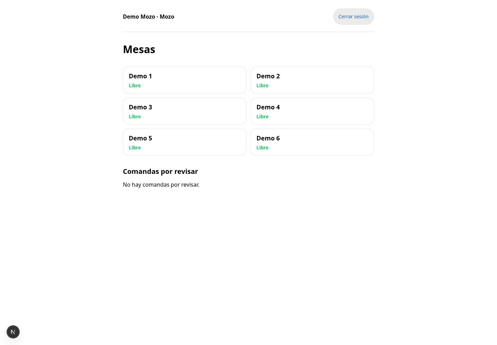
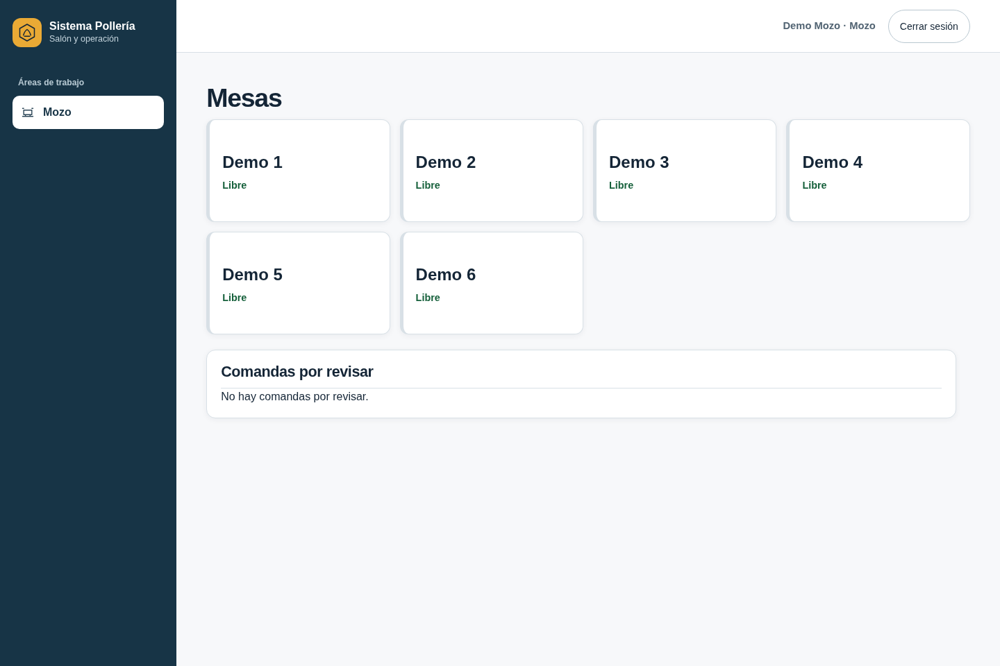
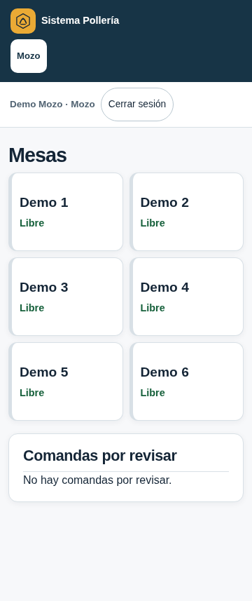
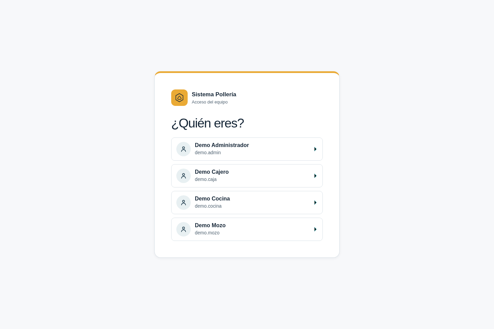
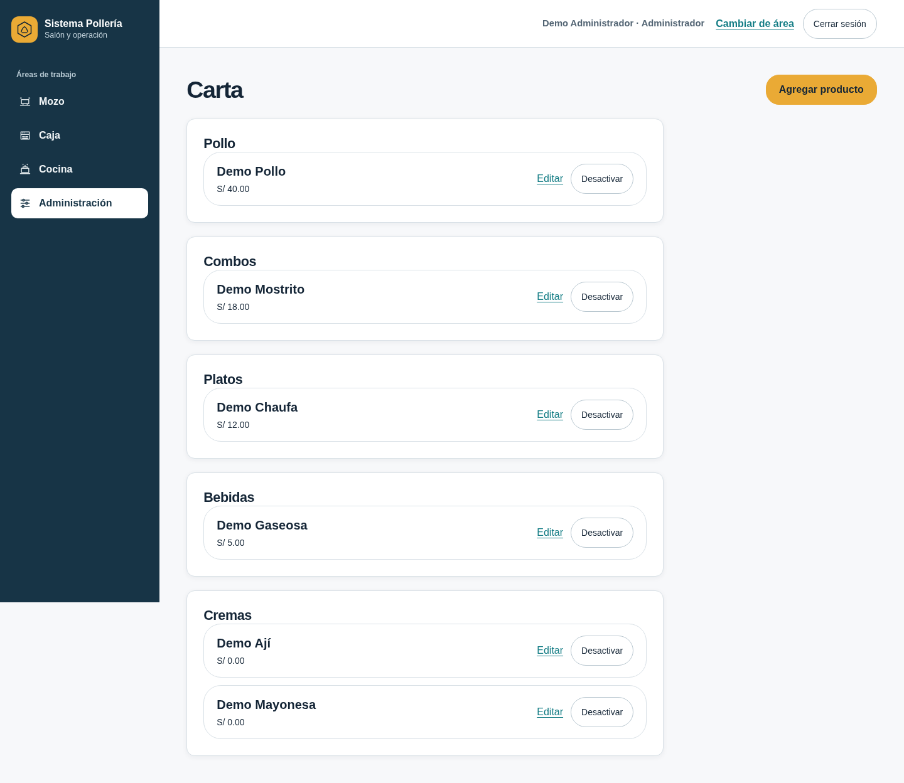

# Rediseño de interfaz — rama dev

Entrega visual del 2026-10-13. Se renovaron el acceso/PIN, navegación, salón, pedido/carrito y administración. En PC hay navegación lateral; en móvil una cabecera compacta, mesas en dos columnas y controles táctiles. Los estados de impresión siguen visibles; caja y cocina conservan sus funciones actuales.

Skills instaladas en el proyecto y aplicadas al diseño:

- [frontend-design](https://www.skills.sh/anthropics/skills/frontend-design)
- [web-design-guidelines](https://www.skills.sh/vercel-labs/agent-skills/web-design-guidelines)
- [ui-ux-pro-max](https://www.skills.sh/nextlevelbuilder/ui-ux-pro-max-skill/ui-ux-pro-max)

Sus archivos y licencias permanecen en `.agents/skills/`; `skills-lock.json` registra su origen. No se añadieron dependencias de la aplicación, fuentes remotas ni cambios de base de datos.

## Comparación de salón

Antes:



Ahora, escritorio:



Ahora, celular de 360 px:



## Acceso y administración





## Probar

Si ya cargaste la demo, detén el servidor y ejecuta:

```sh
git switch dev
git pull --ff-only origin dev
pnpm dev
```

Conserva tu `.env` y tus datos. Si aún no preparaste la base, sigue [PROBAR-DEMO.md](../PROBAR-DEMO.md). El rediseño no incluye el cobro de la spec 014; esa implementación sigue separada.

## Verificación

Capturas y recorrido con usuarios Demo reales a 360, 768 y 1440 px: acceso, áreas, salón, administración/usuarios/carta/mesas y formularios, caja y cocina. Sin desbordamiento horizontal, errores de página ni recursos remotos. Comprobados foco de teclado, salto al contenido, nombres accesibles y contraste de acciones (7,64:1 normal y 5,93:1 hover).

E2E: 28 aprobados y 12 omitidos por aplicabilidad desktop/móvil, con Chromium del sistema 154 y base aislada polleria_test. Tipos globales y formato aprobados. Build de producción aprobado; resuelta la deuda SSR de getServerSnapshot. Pruebas web finales: 41 archivos y 734 pruebas aprobados. Lint global sin warnings y git diff --check aprobados. No se reejecutó cobertura global ni suite API; revisión del principal sin ronda independiente.
